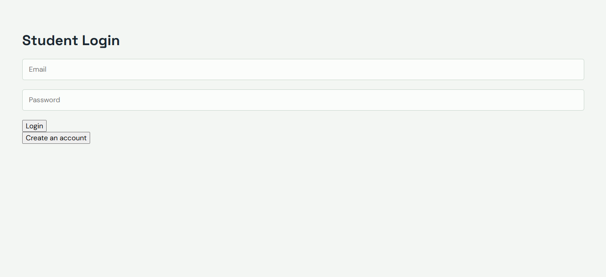
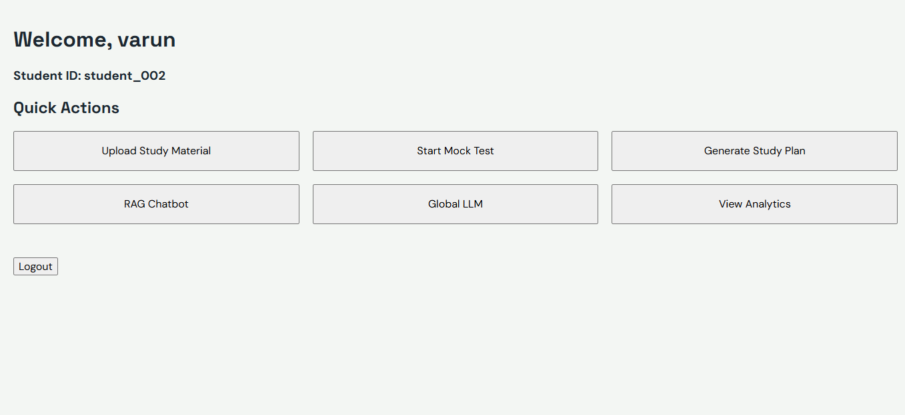
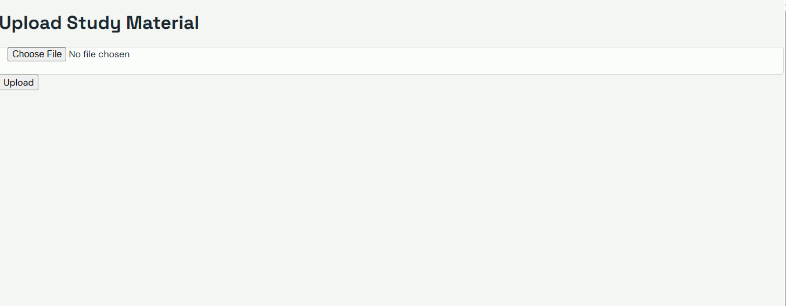
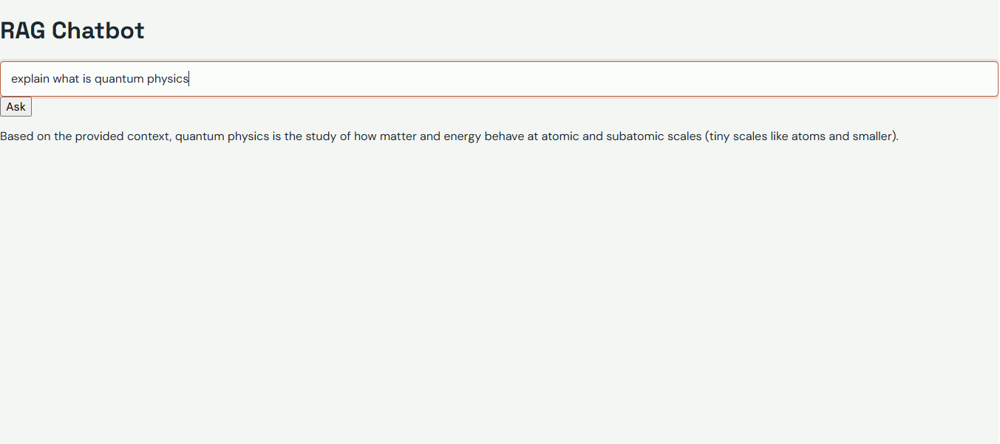
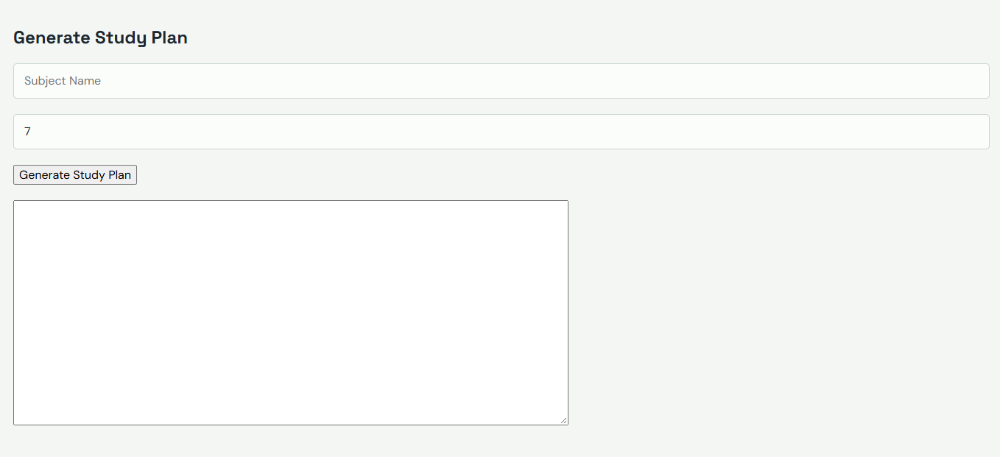
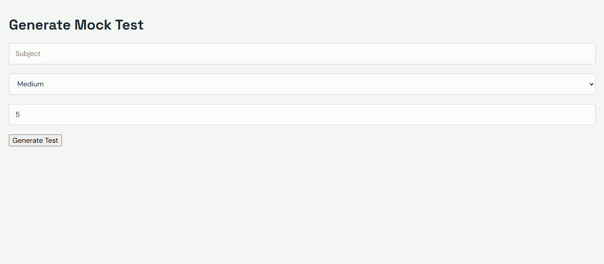

# Student Helper GenAI

An AI-powered student assistant built with React, FastAPI,
RAG, ChromaDB, and Google Gemini.

## 📸 Application Screenshots

### 1. Login Page

### 2. Dashboard

### 3. PDF Upload

### 4. RAG Chatbot

### 5. Study Planner

### 6. Mock Test

